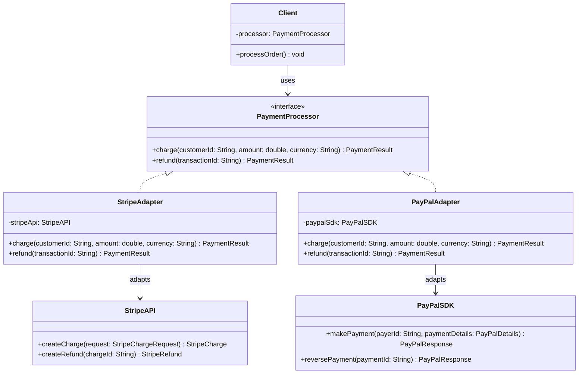

# Adapter Pattern

## 1. Problem

### What real software problem does this pattern solve?

You have **existing code that works** but its interface doesn't match what your system expects. You can't (or shouldn't) modify the existing code — it might be a third-party library, a legacy system, or code owned by another team.

```java
// Your system expects this interface
interface PaymentProcessor {
    PaymentResult charge(String customerId, double amount, String currency);
}

// But the third-party Stripe SDK has THIS interface
class StripeAPI {
    StripeCharge createCharge(StripeChargeRequest request) { ... }
}

// These two are incompatible. Your code can't call StripeAPI directly
// without scattering Stripe-specific logic everywhere.
```

### What becomes difficult without it?

- **Tight coupling to third-party APIs** — Your business logic becomes littered with vendor-specific code. Switching vendors means rewriting everywhere.
- **Can't use polymorphism** — If Stripe and PayPal have different interfaces, you can't treat them interchangeably.
- **Violates Dependency Inversion** — High-level modules depend on low-level third-party details.
- **Legacy integration is painful** — Old code with incompatible interfaces can't be used with new systems.
- **Testing is hard** — You can't mock a third-party class that doesn't implement your interface.

---

## 2. Core Idea

The Adapter pattern **wraps an object with an incompatible interface** inside a new class that translates calls from the interface your code expects into calls the wrapped object understands. The adapter implements your target interface and internally converts/delegates to the adaptee. The client only interacts with the target interface.

**Think of it like a power plug adapter:** Your laptop has a US plug. The wall socket in Europe is different. The adapter doesn't change your laptop or the socket — it sits between them and makes them compatible.

---

## 3. When to Use It

| Signal | Example |
|--------|---------|
| You're **integrating a third-party library** whose API doesn't match yours | Wrapping Stripe/PayPal/Twilio behind your own interface |
| You need to **swap implementations** without changing client code | Switch from SendGrid to Amazon SES for email |
| You're working with **legacy code** you can't modify | Wrapping an old SOAP service behind a REST-style interface |
| You want to **decouple** your system from external dependencies | All external calls go through adapters you control |
| Multiple external systems have **different interfaces** for the same concept | Different payment gateways, different notification APIs |

---

## 4. When NOT to Use It

| Situation | Why it's harmful |
|-----------|-----------------|
| You **own the code** and can change its interface | Just change the interface directly — no adapter needed |
| The interfaces are **already compatible** | Wrapping something just to wrap it adds pointless indirection |
| You're creating adapters for **internal code** that you control | Fix the design instead of papering over it |
| The adaptee's interface is **too complex** to adapt cleanly | If adapting requires a massive translation layer, consider a different integration approach (e.g., Façade) |
| You only have **one implementation** and will never swap | The adapter's value comes from substitutability — without it, it's just indirection |

> **Rule of thumb:** Use adapters at **system boundaries** (third-party libs, legacy systems, external APIs). Don't use them between components you own.

---

## 5. Structure

### Classes/Interfaces Involved

| Component | Role |
|-----------|------|
| `Target` (interface) | The interface your system expects and programs against |
| `Adaptee` | The existing class with the incompatible interface (e.g., third-party SDK) |
| `Adapter` | Implements the Target interface. Internally holds an Adaptee and translates calls |
| `Client` | Works with the Target interface — doesn't know about the Adaptee |

### Who Calls Whom

```
Client  →  adapter.targetMethod(params)
                └──→  translates params
                └──→  adaptee.differentMethod(translatedParams)
                └──→  translates result back
                └──→  returns Target-compatible result
```

### Class Diagram



---

## 6. How to Code (Step-by-Step Recipe)

### Step 1: Define the Target Interface (1 interface)

This is the interface **your system expects**. Design it around your domain, NOT around any third-party API.

```java
interface Target {
    Result doSomething(MyParams params);
}
```

**Ask yourself:** "What interface would my system ideally want, ignoring how external systems work?"

### Step 2: Identify the Adaptee (existing class — 0 new classes)

This already exists. It's the third-party library, legacy code, or external API you need to integrate.

```java
// You DON'T write this — it already exists
class ThirdPartyLib {
    ThirdPartyResult theirMethod(TheirParams params) { ... }
}
```

### Step 3: Create the Adapter (1 class)

The adapter:
- **Implements** the Target interface
- **Holds a reference** to the Adaptee (composition)
- **Translates** method calls and data formats between your interface and the adaptee's interface

```java
class ThirdPartyAdapter implements Target {
    private ThirdPartyLib adaptee;   // ← hold the adaptee

    public ThirdPartyAdapter(ThirdPartyLib adaptee) {
        this.adaptee = adaptee;
    }

    @Override
    public Result doSomething(MyParams params) {
        // 1. TRANSLATE input: your format → their format
        TheirParams translated = convertParams(params);

        // 2. DELEGATE: call the adaptee
        ThirdPartyResult theirResult = adaptee.theirMethod(translated);

        // 3. TRANSLATE output: their format → your format
        return convertResult(theirResult);
    }
}
```

### Step 4: Client Uses Only the Target Interface

```java
Target service = new ThirdPartyAdapter(new ThirdPartyLib());
Result r = service.doSomething(myParams); // client doesn't know about ThirdPartyLib
```

### Summary Checklist

| What to create | Count | Purpose |
|---------------|-------|---------|
| Target interface | 1 | Your system's expected interface |
| Adaptee | 0 (already exists) | The incompatible class you're wrapping |
| Adapter class | 1 per adaptee | Translates between Target and Adaptee |
| Data translation methods | As needed | Convert between your types and theirs |

### Two Types of Adapters

| Type | How | When |
|------|-----|------|
| **Object Adapter** (composition) | Adapter *holds* an adaptee instance | **Preferred.** More flexible, works with adaptee subclasses |
| **Class Adapter** (inheritance) | Adapter *extends* the adaptee | Rarely used in Java (single inheritance). Avoids wrapping but creates tight coupling |

**Always prefer Object Adapter** (composition over inheritance).

---

## 7. Code Implementation

### Example: Payment Gateway Integration

```java
// ─────────────────────────────────────────────
// STEP 1: Target Interface (what YOUR system expects)
// ─────────────────────────────────────────────
public class PaymentResult {
    private String transactionId;
    private boolean success;
    private String message;
    private double amountCharged;

    public PaymentResult(String transactionId, boolean success,
                         String message, double amountCharged) {
        this.transactionId = transactionId;
        this.success = success;
        this.message = message;
        this.amountCharged = amountCharged;
    }

    // Getters
    public String getTransactionId() { return transactionId; }
    public boolean isSuccess()       { return success; }
    public String getMessage()       { return message; }
    public double getAmountCharged() { return amountCharged; }

    @Override
    public String toString() {
        return String.format("PaymentResult{txn='%s', success=%b, msg='%s', amount=%.2f}",
            transactionId, success, message, amountCharged);
    }
}

public interface PaymentProcessor {
    PaymentResult charge(String customerId, double amount, String currency);
    PaymentResult refund(String transactionId);
}

// ─────────────────────────────────────────────
// STEP 2: Adaptees (third-party SDKs — you DON'T control these)
// ─────────────────────────────────────────────

// --- Stripe SDK (simulated) ---
class StripeChargeRequest {
    String source;
    long amountInCents; // Stripe uses cents, not dollars!
    String currency;

    StripeChargeRequest(String source, long amountInCents, String currency) {
        this.source = source;
        this.amountInCents = amountInCents;
        this.currency = currency;
    }
}

class StripeCharge {
    String id;
    String status;
    long amount;

    StripeCharge(String id, String status, long amount) {
        this.id = id;
        this.status = status;
        this.amount = amount;
    }
}

class StripeAPI {
    public StripeCharge createCharge(StripeChargeRequest request) {
        System.out.println("[Stripe SDK] Creating charge: " + request.amountInCents + " cents");
        return new StripeCharge("ch_stripe_" + System.currentTimeMillis(), "succeeded", request.amountInCents);
    }

    public StripeCharge refundCharge(String chargeId) {
        System.out.println("[Stripe SDK] Refunding charge: " + chargeId);
        return new StripeCharge(chargeId, "refunded", 0);
    }
}

// --- PayPal SDK (simulated) — completely different interface ---
class PayPalDetails {
    String payerId;
    double total;
    String currencyCode;

    PayPalDetails(String payerId, double total, String currencyCode) {
        this.payerId = payerId;
        this.total = total;
        this.currencyCode = currencyCode;
    }
}

class PayPalResponse {
    String paymentId;
    String state; // "approved" or "failed"
    double amount;

    PayPalResponse(String paymentId, String state, double amount) {
        this.paymentId = paymentId;
        this.state = state;
        this.amount = amount;
    }
}

class PayPalSDK {
    public PayPalResponse makePayment(PayPalDetails details) {
        System.out.println("[PayPal SDK] Making payment: $" + details.total);
        return new PayPalResponse("PAY-pp_" + System.currentTimeMillis(), "approved", details.total);
    }

    public PayPalResponse reversePayment(String paymentId) {
        System.out.println("[PayPal SDK] Reversing payment: " + paymentId);
        return new PayPalResponse(paymentId, "refunded", 0);
    }
}

// ─────────────────────────────────────────────
// STEP 3: Adapters (translate between YOUR interface and THEIRS)
// ─────────────────────────────────────────────

public class StripeAdapter implements PaymentProcessor {
    private StripeAPI stripeApi;

    public StripeAdapter(StripeAPI stripeApi) {
        this.stripeApi = stripeApi;
    }

    @Override
    public PaymentResult charge(String customerId, double amount, String currency) {
        // TRANSLATE: dollars → cents (Stripe-specific conversion!)
        long amountInCents = Math.round(amount * 100);

        // TRANSLATE: our params → Stripe's StripeChargeRequest
        StripeChargeRequest request = new StripeChargeRequest(customerId, amountInCents, currency);

        // DELEGATE to adaptee
        StripeCharge charge = stripeApi.createCharge(request);

        // TRANSLATE: Stripe's response → our PaymentResult
        return new PaymentResult(
            charge.id,
            "succeeded".equals(charge.status),
            "Stripe charge " + charge.status,
            amount
        );
    }

    @Override
    public PaymentResult refund(String transactionId) {
        StripeCharge refund = stripeApi.refundCharge(transactionId);
        return new PaymentResult(
            refund.id,
            "refunded".equals(refund.status),
            "Stripe refund " + refund.status,
            0
        );
    }
}

public class PayPalAdapter implements PaymentProcessor {
    private PayPalSDK paypalSdk;

    public PayPalAdapter(PayPalSDK paypalSdk) {
        this.paypalSdk = paypalSdk;
    }

    @Override
    public PaymentResult charge(String customerId, double amount, String currency) {
        // TRANSLATE: our params → PayPal's PayPalDetails
        PayPalDetails details = new PayPalDetails(customerId, amount, currency);

        // DELEGATE to adaptee
        PayPalResponse response = paypalSdk.makePayment(details);

        // TRANSLATE: PayPal's response → our PaymentResult
        return new PaymentResult(
            response.paymentId,
            "approved".equals(response.state),
            "PayPal payment " + response.state,
            response.amount
        );
    }

    @Override
    public PaymentResult refund(String transactionId) {
        PayPalResponse response = paypalSdk.reversePayment(transactionId);
        return new PaymentResult(
            response.paymentId,
            "refunded".equals(response.state),
            "PayPal refund " + response.state,
            0
        );
    }
}

// ─────────────────────────────────────────────
// STEP 4: Client — uses only PaymentProcessor interface
// ─────────────────────────────────────────────
public class OrderService {
    private PaymentProcessor paymentProcessor;

    // Inject any adapter — client doesn't know if it's Stripe, PayPal, or anything else
    public OrderService(PaymentProcessor paymentProcessor) {
        this.paymentProcessor = paymentProcessor;
    }

    public void processOrder(String customerId, double total) {
        System.out.println("Processing order for customer: " + customerId);

        PaymentResult result = paymentProcessor.charge(customerId, total, "USD");

        if (result.isSuccess()) {
            System.out.println("✅ Payment successful: " + result);
        } else {
            System.out.println("❌ Payment failed: " + result);
        }
    }

    public static void main(String[] args) {
        System.out.println("=== Using Stripe ===");
        OrderService stripeService = new OrderService(new StripeAdapter(new StripeAPI()));
        stripeService.processOrder("cust_123", 99.99);

        System.out.println();

        System.out.println("=== Using PayPal ===");
        OrderService paypalService = new OrderService(new PayPalAdapter(new PayPalSDK()));
        paypalService.processOrder("cust_456", 149.50);

        // Switching payment providers requires ZERO changes to OrderService!
    }
}
```

**Output:**
```
=== Using Stripe ===
Processing order for customer: cust_123
[Stripe SDK] Creating charge: 9999 cents
✅ Payment successful: PaymentResult{txn='ch_stripe_1696700000001', success=true, msg='Stripe charge succeeded', amount=99.99}

=== Using PayPal ===
Processing order for customer: cust_456
[PayPal SDK] Making payment: $149.5
✅ Payment successful: PaymentResult{txn='PAY-pp_1696700000002', success=true, msg='PayPal payment approved', amount=149.50}
```

---

## 8. Real-World Examples

| Where | How Adapter is used |
|-------|-------------------|
| **SLF4J logging** | SLF4J is a target interface; `slf4j-log4j12`, `logback-classic` are adapters that translate SLF4J calls to Log4j/Logback |
| **JDBC Drivers** | `java.sql.Connection` is the target; each database vendor provides an adapter (MySQL driver, Postgres driver) |
| **Spring `HandlerAdapter`** | Adapts different types of controllers (annotated, simple, etc.) to Spring's `DispatcherServlet` |
| **Jackson `ObjectMapper`** | Adapts between Java objects and JSON — your domain ↔ wire format |
| **Arrays.asList()** | Adapts an array to the `List` interface |
| **AWS SDK wrappers** | Companies wrap AWS SDK calls behind their own interfaces for testability and vendor-independence |
| **GraphQL resolvers** | Adapt between GraphQL query format and backend service calls |

---

## 9. Trade-offs

### ✅ Advantages

- **Decouples your code from third-party APIs** — Switching vendors means writing a new adapter, not rewriting your system
- **Single Responsibility** — Translation logic is isolated in one class
- **Testability** — Mock your target interface; never mock third-party SDKs
- **Open/Closed Principle** — Add new adapters without modifying existing code
- **Clean architecture** — External dependencies live at the boundary, not in your core

### ❌ Disadvantages

- **Extra indirection** — One more layer between your code and the actual implementation
- **Translation complexity** — If the adaptee's interface is very different, the adapter can become complex with lots of data conversion
- **Performance overhead** — Data conversion between formats adds CPU/memory cost
- **Can mask problems** — An adapter might hide the fact that the underlying service has fundamentally different semantics

### Complexity Introduced

| Aspect | Impact |
|--------|--------|
| Number of new classes | 1 interface + 1 adapter per external system |
| Data conversion classes | Often need DTOs/value objects for translation |
| Indirection layers | 1 per adapter |
| Learning curve | Low — very intuitive "wrapper" concept |
| Maintenance burden | Medium — when the third-party API changes, only the adapter needs updating (that's the point!) |
