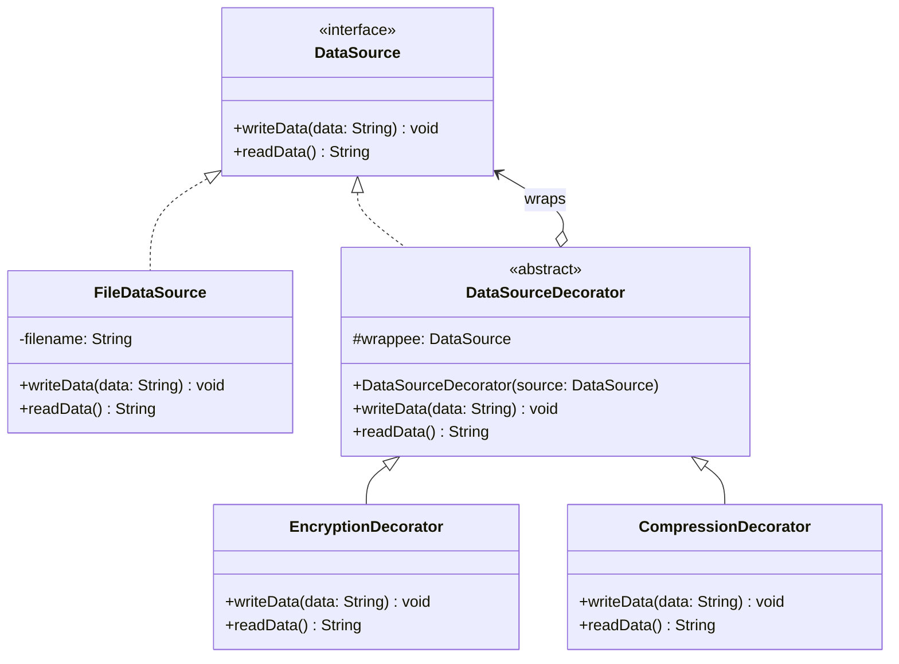

# Decorator Pattern

## 1. Problem

### What real software problem does this pattern solve?

You want to **add behavior to an object** without modifying its class. You might want to add logging, caching, encryption, compression, or authentication — but you don't want to change the original class, and you might want to **stack** multiple behaviors.

Without this pattern, you end up with a **class explosion**:

```
// Without Decorator — exponential class combinations
DataSource
├── EncryptedDataSource
├── CompressedDataSource
├── LoggingDataSource
├── EncryptedCompressedDataSource
├── EncryptedLoggingDataSource
├── CompressedLoggingDataSource
└── EncryptedCompressedLoggingDataSource   // 😱 this keeps growing
```

### What becomes difficult without it?

- **Class explosion** — Every combination of features requires a new subclass. With 4 features, you need up to 2⁴ = 16 subclasses.
- **Inheritance is static** — You choose the behavior at compile time, not runtime.
- **Single inheritance limitation** — In Java, a class can extend only one parent. You can't mix `EncryptedDataSource` and `CompressedDataSource` via inheritance.
- **Modifying the original class** violates Open/Closed Principle — Adding logging to `DataSource` affects all users of that class.

---

## 2. Core Idea

The Decorator pattern lets you **wrap an object inside another object** that adds behavior before/after delegating to the wrapped object. Both the wrapper and the wrapped object share the same interface, so the client doesn't know (or care) whether it's talking to the original or a decorated version. You can stack decorators like layers — each one adds one concern.

**Think of it like clothing:** You don't modify your body to stay warm. You *wrap* it — t-shirt, then sweater, then jacket. Each layer adds warmth, and you can add/remove layers independently.

---

## 3. When to Use It

| Signal | Example |
|--------|---------|
| You need to **add responsibilities dynamically** | Add logging to some API calls but not others, at runtime |
| You want to **stack behaviors** | Encrypt → Compress → Log, in any combination |
| **Inheritance would cause class explosion** | 4 features × 2 states = 16 subclasses vs 4 decorators |
| The enhancement is **orthogonal** to the core logic | Caching doesn't change what a service does, just how often it does it |
| You need **the same interface** before and after adding behavior | Decorated object is a drop-in replacement for the original |

---

## 4. When NOT to Use It

| Situation | Why it's harmful |
|-----------|-----------------|
| You need to **change the interface** | Decorators must implement the same interface — if you need new methods, use a different pattern |
| The behavior is **always required** | If encryption is always on, just put it in the class. No need for a decorator. |
| **Order of decoration matters** and is confusing | 3+ nested decorators become hard to debug: `new A(new B(new C(real)))` — what's the actual call order? |
| The **wrapping creates too much boilerplate** | If the interface has 20 methods and the decorator only modifies 1, you write 19 passthrough methods |
| You're using it to **avoid modifying a class you own** | If it's your code and the change is permanent, just modify the class. Don't over-engineer. |

> **Rule of thumb:** If you won't ever need to remove the behavior or stack it with other behaviors, consider modifying the class directly.

---

## 5. Structure

### Classes/Interfaces Involved

| Component | Role |
|-----------|------|
| `Component` (interface) | Declares the operations that both the real object and decorators share |
| `ConcreteComponent` | The original object with core behavior |
| `BaseDecorator` (abstract class) | Implements Component, holds a reference to a wrapped Component, delegates calls to it |
| `ConcreteDecoratorA`, `ConcreteDecoratorB` | Extend BaseDecorator, add specific behavior before/after delegating |

### Who Calls Whom

```
Client  →  DecoratorB.operation()
               └──→  DecoratorA.operation()    (DecoratorB wraps DecoratorA)
                          └──→  ConcreteComponent.operation()    (DecoratorA wraps the real object)
```

Each decorator calls `super.operation()` or `wrappedComponent.operation()` — this chains through all layers.

### Class Diagram



---

## 6. How to Code (Step-by-Step Recipe)

### Step 1: Define the Component Interface (1 interface)

This is the contract shared by both the real object and all decorators.

```java
interface Component {
    void operation();
}
```

**Key rule:** Keep this interface **focused**. Every method here must be implemented by every decorator.

### Step 2: Create the Concrete Component (1 class)

The real object with the core logic.

```java
class ConcreteComponent implements Component {
    public void operation() {
        // Real work happens here
    }
}
```

### Step 3: Create the Base Decorator (1 abstract class)

This is the **key structural piece**. It:
- Implements the Component interface
- Holds a reference to a wrapped Component
- Delegates all calls to the wrapped Component by default

```java
abstract class BaseDecorator implements Component {
    protected Component wrappee;       // ← the object being decorated

    public BaseDecorator(Component wrappee) {
        this.wrappee = wrappee;        // ← accept any Component (real or decorated)
    }

    @Override
    public void operation() {
        wrappee.operation();           // ← delegate by default
    }
}
```

**This class exists so that concrete decorators only override what they need** — everything else passes through automatically.

### Step 4: Create Concrete Decorators (N classes, one per behavior)

Each decorator extends BaseDecorator and adds its behavior before/after calling `super.operation()`.

```java
class LoggingDecorator extends BaseDecorator {
    public LoggingDecorator(Component wrappee) {
        super(wrappee);
    }

    @Override
    public void operation() {
        System.out.println("[LOG] Before operation");
        super.operation();             // ← delegate to wrapped object
        System.out.println("[LOG] After operation");
    }
}
```

### Step 5: Client Wraps Objects Like Layers

```java
// Core object
Component service = new ConcreteComponent();

// Wrap with logging
service = new LoggingDecorator(service);

// Wrap with caching (stacked on top of logging)
service = new CachingDecorator(service);

// Client calls the same interface — doesn't know about decorators
service.operation();
```

### Summary Checklist

| What to create | Count | Purpose |
|---------------|-------|---------|
| Component interface | 1 | Common contract for all |
| Concrete Component | 1 (or more) | The real object |
| Base Decorator (abstract) | 1 | Holds `wrappee` reference, delegates by default |
| Concrete Decorators | N (one per behavior) | Each adds one specific behavior |

### The Wrapping Pattern (Memory Trick)

```
new DecoratorC(
    new DecoratorB(
        new DecoratorA(
            new RealObject()        ← innermost: the real thing
        )                           ← first layer: adds behavior A
    )                               ← second layer: adds behavior B
)                                   ← third layer: adds behavior C

Call order:  C → B → A → RealObject → A → B → C
             (before)       ↑          (after)
                        core logic
```

---

## 7. Code Implementation

### Example: Data Source with Encryption and Compression

```java
// ─────────────────────────────────────────────
// STEP 1: Component Interface
// ─────────────────────────────────────────────
public interface DataSource {
    void writeData(String data);
    String readData();
}

// ─────────────────────────────────────────────
// STEP 2: Concrete Component
// ─────────────────────────────────────────────
public class FileDataSource implements DataSource {
    private String filename;
    private String storedData = "";

    public FileDataSource(String filename) {
        this.filename = filename;
    }

    @Override
    public void writeData(String data) {
        System.out.println("[FILE] Writing to " + filename);
        this.storedData = data;
    }

    @Override
    public String readData() {
        System.out.println("[FILE] Reading from " + filename);
        return this.storedData;
    }
}

// ─────────────────────────────────────────────
// STEP 3: Base Decorator — abstract, delegates everything
// ─────────────────────────────────────────────
public abstract class DataSourceDecorator implements DataSource {
    protected DataSource wrappee;

    public DataSourceDecorator(DataSource source) {
        this.wrappee = source;
    }

    @Override
    public void writeData(String data) {
        wrappee.writeData(data);   // delegate by default
    }

    @Override
    public String readData() {
        return wrappee.readData(); // delegate by default
    }
}

// ─────────────────────────────────────────────
// STEP 4a: Concrete Decorator — Encryption
// ─────────────────────────────────────────────
public class EncryptionDecorator extends DataSourceDecorator {

    public EncryptionDecorator(DataSource source) {
        super(source);
    }

    @Override
    public void writeData(String data) {
        // Add behavior BEFORE delegating
        String encrypted = encrypt(data);
        System.out.println("[ENCRYPT] Data encrypted");
        super.writeData(encrypted); // pass encrypted data down the chain
    }

    @Override
    public String readData() {
        // Add behavior AFTER delegating
        String data = super.readData(); // get data from the chain
        String decrypted = decrypt(data);
        System.out.println("[ENCRYPT] Data decrypted");
        return decrypted;
    }

    // Simple Base64 "encryption" for demo purposes
    private String encrypt(String data) {
        return java.util.Base64.getEncoder().encodeToString(data.getBytes());
    }

    private String decrypt(String data) {
        return new String(java.util.Base64.getDecoder().decode(data));
    }
}

// ─────────────────────────────────────────────
// STEP 4b: Concrete Decorator — Compression
// ─────────────────────────────────────────────
public class CompressionDecorator extends DataSourceDecorator {

    public CompressionDecorator(DataSource source) {
        super(source);
    }

    @Override
    public void writeData(String data) {
        String compressed = compress(data);
        System.out.println("[COMPRESS] Data compressed (" + data.length() + " → " + compressed.length() + " chars)");
        super.writeData(compressed);
    }

    @Override
    public String readData() {
        String data = super.readData();
        String decompressed = decompress(data);
        System.out.println("[COMPRESS] Data decompressed");
        return decompressed;
    }

    // Simple "compression" for demo — just removes spaces
    private String compress(String data) {
        return data.replace(" ", "");
    }

    private String decompress(String data) {
        // In reality, you'd use proper compression/decompression
        return data; // simplified for demo
    }
}

// ─────────────────────────────────────────────
// STEP 4c: Concrete Decorator — Logging
// ─────────────────────────────────────────────
public class LoggingDecorator extends DataSourceDecorator {

    public LoggingDecorator(DataSource source) {
        super(source);
    }

    @Override
    public void writeData(String data) {
        System.out.println("[LOG] Write operation started at " + java.time.Instant.now());
        super.writeData(data);
        System.out.println("[LOG] Write operation completed");
    }

    @Override
    public String readData() {
        System.out.println("[LOG] Read operation started at " + java.time.Instant.now());
        String data = super.readData();
        System.out.println("[LOG] Read operation completed");
        return data;
    }
}

// ─────────────────────────────────────────────
// STEP 5: Client — stack decorators
// ─────────────────────────────────────────────
public class Main {
    public static void main(String[] args) {

        // Plain file — no decoration
        System.out.println("=== Plain FileDataSource ===");
        DataSource file = new FileDataSource("data.txt");
        file.writeData("Hello World");
        System.out.println("Read: " + file.readData());

        System.out.println();

        // Decorated: Logging → Encryption → File
        // Read order:  Logging → Encryption → File → Encryption → Logging
        System.out.println("=== With Encryption + Logging ===");
        DataSource decorated = new LoggingDecorator(
            new EncryptionDecorator(
                new FileDataSource("secret.txt")
            )
        );

        decorated.writeData("Sensitive data: SSN 123-45-6789");
        System.out.println();
        String result = decorated.readData();
        System.out.println("Read: " + result);

        System.out.println();

        // Full stack: Logging → Compression → Encryption → File
        System.out.println("=== Full Stack: Logging + Compression + Encryption ===");
        DataSource fullStack = new LoggingDecorator(
            new CompressionDecorator(
                new EncryptionDecorator(
                    new FileDataSource("archive.dat")
                )
            )
        );

        fullStack.writeData("This is a long message with lots of spaces for compression");
        System.out.println();
        System.out.println("Read: " + fullStack.readData());
    }
}
```

**Output:**
```
=== Plain FileDataSource ===
[FILE] Writing to data.txt
[FILE] Reading from data.txt
Read: Hello World

=== With Encryption + Logging ===
[LOG] Write operation started at 2024-01-15T10:30:00Z
[ENCRYPT] Data encrypted
[FILE] Writing to secret.txt
[LOG] Write operation completed

[LOG] Read operation started at 2024-01-15T10:30:00Z
[FILE] Reading from secret.txt
[ENCRYPT] Data decrypted
[LOG] Read operation completed
Read: Sensitive data: SSN 123-45-6789

=== Full Stack: Logging + Compression + Encryption ===
[LOG] Write operation started at 2024-01-15T10:30:00Z
[COMPRESS] Data compressed (58 → 49 chars)
[ENCRYPT] Data encrypted
[FILE] Writing to archive.dat
[LOG] Write operation completed

[LOG] Read operation started at 2024-01-15T10:30:00Z
[FILE] Reading from archive.dat
[ENCRYPT] Data decrypted
[COMPRESS] Data decompressed
[LOG] Read operation completed
Read: Thisisalongmessagewithlotsofspacesforcompression
```

---

## 8. Real-World Examples

| Where | How Decorator is used |
|-------|---------------------|
| **Java I/O Streams** | `new BufferedInputStream(new FileInputStream("file.txt"))` — classic decorator. `BufferedInputStream` decorates `FileInputStream` |
| **`Collections.unmodifiableList()`** | Returns a decorator that throws on mutation methods |
| **`Collections.synchronizedList()`** | Returns a decorator that adds thread-safety to any list |
| **Spring `HandlerInterceptor`** | Decorates request handlers with pre/post processing (auth, logging) |
| **Middleware in Express.js / Servlet Filters** | Each middleware wraps the next — adding auth, CORS, compression, etc. |
| **HTTP Client interceptors (OkHttp)** | Interceptors decorate HTTP calls with logging, retry, auth headers |
| **`@Transactional` in Spring** | A proxy (AOP decorator) wraps your service method with transaction begin/commit/rollback |

---

## 9. Trade-offs

### ✅ Advantages

- **Open/Closed Principle** — Add new behaviors without modifying existing classes
- **Single Responsibility** — Each decorator handles one concern (logging, caching, encryption)
- **Composable** — Stack behaviors in any order, add/remove at runtime
- **No class explosion** — N behaviors = N decorator classes, not 2^N subclasses
- **Same interface** — Decorators are transparent to the client

### ❌ Disadvantages

- **Nested wrapping is hard to read** — `new A(new B(new C(new D(real))))` is confusing
- **Debugging is tricky** — Stack traces show many layers of delegation
- **Order matters** — `Encrypt(Compress(data))` ≠ `Compress(Encrypt(data))`
- **Boilerplate** — Each decorator must implement/delegate ALL methods of the interface
- **Identity issues** — `decorated == original` is `false`, and `instanceof ConcreteComponent` fails on decorated objects

### Complexity Introduced

| Aspect | Impact |
|--------|--------|
| Number of new classes | 1 interface + 1 base decorator + N concrete decorators |
| Indirection layers | 1 per decorator (can stack to many layers) |
| Learning curve | Medium — the "wrapping" concept is intuitive but nesting is not |
| Maintenance burden | Medium — adding a method to the interface requires updating ALL decorators |
| Debugging difficulty | High with many layers — use logging in each decorator to trace flow |
