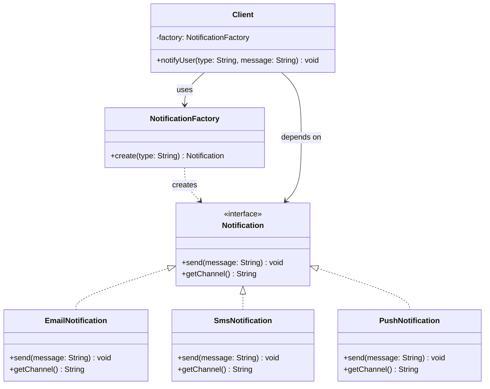

# Factory Pattern

## 1. Problem

### What real software problem does this pattern solve?

You need to create objects, but you **don't know ahead of time which exact class** to instantiate. The decision depends on runtime data — a config value, user input, a file type, a request parameter, etc.

Without this pattern, your code ends up littered with conditional logic:

```java
// Scattered across your codebase — every place that creates a notification
if (type.equals("email")) {
    notification = new EmailNotification();
} else if (type.equals("sms")) {
    notification = new SmsNotification();
} else if (type.equals("push")) {
    notification = new PushNotification();
}
```

### What becomes difficult without it?

- **Adding a new type** means hunting through the entire codebase for every `if/else` chain and updating each one.
- **Client code is tightly coupled** to concrete classes — it must `import` and `know about` every possible implementation.
- **Testing becomes painful** because you can't easily swap out real implementations for mocks.
- **Open/Closed Principle is violated** — you modify existing code instead of extending it.

---

## 2. Core Idea

The Factory pattern **delegates object creation to a separate method or class** instead of using `new` directly in client code. The client asks for an object through an interface, and the factory decides which concrete class to instantiate. This way, the client depends only on the abstraction, not on specific implementations.

---

## 3. When to Use It

| Signal | Example |
|--------|---------|
| You have a family of classes sharing an interface | `EmailNotification`, `SmsNotification`, `PushNotification` all implement `Notification` |
| Object creation depends on runtime data | A config file specifies `"database": "postgres"` vs `"mysql"` |
| You see `if/else` or `switch` chains creating different objects | Parsing different file formats based on file extension |
| You want to hide complex construction logic | Creating objects that need multiple setup steps |
| You want to make code testable | Inject a factory that returns mocks during testing |

---

## 4. When NOT to Use It

| Situation | Why it's harmful |
|-----------|-----------------|
| You only ever create **one type** of object | A factory for a single class adds indirection with zero benefit |
| Object creation is **trivial** and won't change | `new ArrayList<>()` doesn't need a factory |
| You have **2-3 classes** and the `if/else` is in **one place** | A simple `switch` is clearer than an entire factory hierarchy |
| You're adding it "just in case" | YAGNI — You Ain't Gonna Need It. Add the factory when the second or third type appears |
| The types are **not substitutable** | If the created objects don't share a common interface, a factory is the wrong tool |

> **Rule of thumb:** If introducing a factory makes you create more files/classes than the problem warrants, skip it.

---

## 5. Structure

### Classes/Interfaces Involved

| Component | Role |
|-----------|------|
| `Product` (interface) | Defines the common interface all created objects must implement |
| `ConcreteProductA`, `ConcreteProductB` | Actual implementations of the Product interface |
| `Factory` (class or method) | Contains the logic that decides which ConcreteProduct to create |
| `Client` | Calls the Factory — never uses `new ConcreteProduct()` directly |

### Who Calls Whom

```
Client  →  Factory.create(type)  →  returns ConcreteProductA or ConcreteProductB
Client  →  product.doSomething()  (works with the Product interface)
```

### Class Diagram



---

## 6. How to Code (Step-by-Step Recipe)

This is a **repeatable recipe** you can follow every time you implement a Factory:

### Step 1: Define the Product Interface (1 interface)

Create an interface (or abstract class) that declares the common behavior all products share.

```
interface Product {
    void operation();
}
```

**Ask yourself:** What methods do ALL variants need to support?

### Step 2: Create Concrete Products (N classes, one per variant)

Each class implements the Product interface with its own specific behavior.

```
class ConcreteProductA implements Product { ... }
class ConcreteProductB implements Product { ... }
```

**Count:** One class per variant you need to support.

### Step 3: Build the Factory (1 class with 1 static/instance method)

The factory has a single method that takes a **discriminator** (string, enum, config) and returns the correct Product.

```
class ProductFactory {
    static Product create(String type) {
        switch(type) {
            case "A": return new ConcreteProductA();
            case "B": return new ConcreteProductB();
            default: throw new IllegalArgumentException("Unknown type: " + type);
        }
    }
}
```

**Key decisions:**
- Use `static` method for simple cases (Simple Factory)
- Use instance method if the factory itself needs configuration or state
- Use an `enum` instead of raw strings for type safety

### Step 4: Client Uses Only the Interface

```
Product p = ProductFactory.create("A");
p.operation(); // Client never knows or cares about ConcreteProductA
```

### Summary Checklist

| What to create | Count | Purpose |
|---------------|-------|---------|
| Product interface | 1 | Common contract |
| Concrete Product classes | N (one per variant) | Specific implementations |
| Factory class | 1 | Centralized creation logic |
| Client code | uses factory | Never calls `new ConcreteProduct()` directly |

### Common Variations

| Variation | When to use |
|-----------|------------|
| **Simple Factory** (static method) | Most common. One method, one switch/map. |
| **Factory Method** (subclass overrides) | When subclasses should decide what to create. |
| **Abstract Factory** | When you need families of related objects (e.g., UI toolkit for Windows vs Mac). |
| **Registry/Map-based Factory** | When you want to add types without modifying factory code — use a `Map<String, Supplier<Product>>`. |

---

## 7. Code Implementation

### Example: Notification System

```java
// ─────────────────────────────────────────────
// STEP 1: Product Interface
// ─────────────────────────────────────────────
public interface Notification {
    void send(String message);
    String getChannel();
}

// ─────────────────────────────────────────────
// STEP 2: Concrete Products
// ─────────────────────────────────────────────
public class EmailNotification implements Notification {
    @Override
    public void send(String message) {
        System.out.println("[EMAIL] Sending: " + message);
        // In real code: use SMTP client, set headers, etc.
    }

    @Override
    public String getChannel() {
        return "email";
    }
}

public class SmsNotification implements Notification {
    @Override
    public void send(String message) {
        System.out.println("[SMS] Sending: " + message);
        // In real code: call Twilio API, format phone number, etc.
    }

    @Override
    public String getChannel() {
        return "sms";
    }
}

public class PushNotification implements Notification {
    @Override
    public void send(String message) {
        System.out.println("[PUSH] Sending: " + message);
        // In real code: call Firebase Cloud Messaging, etc.
    }

    @Override
    public String getChannel() {
        return "push";
    }
}

// ─────────────────────────────────────────────
// STEP 3: Factory
// ─────────────────────────────────────────────
public class NotificationFactory {

    public static Notification create(String channel) {
        switch (channel.toLowerCase()) {
            case "email": return new EmailNotification();
            case "sms":   return new SmsNotification();
            case "push":  return new PushNotification();
            default:
                throw new IllegalArgumentException(
                    "Unknown notification channel: " + channel
                );
        }
    }
}

// ─────────────────────────────────────────────
// STEP 4: Client Code
// ─────────────────────────────────────────────
public class NotificationService {

    public void notifyUser(String channel, String message) {
        // Client doesn't know or care about concrete classes
        Notification notification = NotificationFactory.create(channel);
        notification.send(message);
        System.out.println("Sent via: " + notification.getChannel());
    }

    public static void main(String[] args) {
        NotificationService service = new NotificationService();

        // These could come from a database, config, or user preference
        service.notifyUser("email", "Your order has shipped!");
        service.notifyUser("sms", "Your OTP is 483920");
        service.notifyUser("push", "New message from Alice");
    }
}
```

**Output:**
```
[EMAIL] Sending: Your order has shipped!
Sent via: email
[SMS] Sending: Your OTP is 483920
Sent via: sms
[PUSH] Sending: New message from Alice
Sent via: push
```

### Bonus: Registry-Based Factory (Open for Extension)

```java
public class NotificationFactory {
    private static final Map<String, Supplier<Notification>> registry = new HashMap<>();

    static {
        // Register default types
        registry.put("email", EmailNotification::new);
        registry.put("sms", SmsNotification::new);
        registry.put("push", PushNotification::new);
    }

    // Add new types WITHOUT modifying existing code
    public static void register(String channel, Supplier<Notification> creator) {
        registry.put(channel.toLowerCase(), creator);
    }

    public static Notification create(String channel) {
        Supplier<Notification> creator = registry.get(channel.toLowerCase());
        if (creator == null) {
            throw new IllegalArgumentException("Unknown channel: " + channel);
        }
        return creator.get();
    }
}

// Now anyone can add a new type:
NotificationFactory.register("slack", SlackNotification::new);
```

---

## 8. Real-World Examples

| Where | How Factory is used |
|-------|-------------------|
| **JDBC `DriverManager.getConnection()`** | You pass a URL string, and it returns the right database `Connection` (MySQL, Postgres, etc.) without you importing driver-specific classes |
| **Spring `BeanFactory`** | The entire Spring IoC container is a factory — you ask for a bean by name/type, and Spring decides how to create and wire it |
| **`DocumentBuilderFactory` (Java XML)** | `DocumentBuilderFactory.newInstance()` creates the right XML parser based on system configuration |
| **`LoggerFactory.getLogger()` (SLF4J)** | Returns the correct logging implementation (Logback, Log4j) based on classpath configuration |
| **Payment gateways in e-commerce** | `PaymentProcessorFactory.create("stripe")` returns a Stripe processor; `create("paypal")` returns PayPal — the checkout code doesn't change |
| **Serialization formats** | `SerializerFactory.create("json")` vs `create("xml")` vs `create("protobuf")` |

---

## 9. Trade-offs

### ✅ Advantages

- **Open/Closed Principle** — Add new types without changing existing client code
- **Single Responsibility** — Object creation logic is centralized in one place
- **Loose coupling** — Client depends on interface, not concrete classes
- **Testability** — Easy to inject a factory that returns mocks/stubs
- **Consistency** — All object creation goes through one path, ensuring proper initialization

### ❌ Disadvantages

- **Extra indirection** — More files, more classes to navigate
- **Can be overkill** — If you only have 1-2 types that won't change, it's unnecessary ceremony
- **Discovery is harder** — `Ctrl+Click` on `new ClassName()` takes you to the constructor; `factory.create()` doesn't
- **Type explosion** — Each new product requires a new class (though this is often necessary regardless)

### Complexity Introduced

| Aspect | Impact |
|--------|--------|
| Number of new files | 1 interface + N implementations + 1 factory = N+2 minimum |
| Indirection layers | 1 extra layer between client and concrete class |
| Learning curve | Low — one of the simplest patterns |
| Maintenance burden | Low if products share a stable interface; high if the interface keeps changing |
