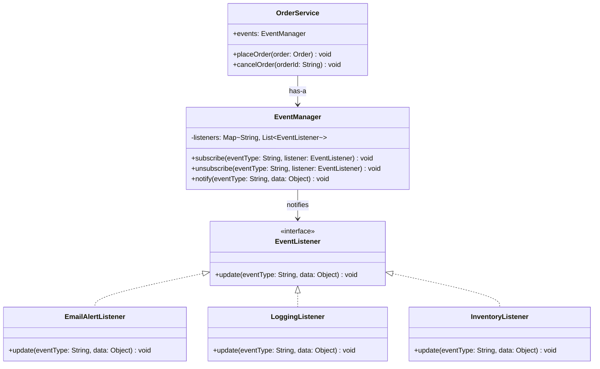

# Observer Pattern

## 1. Problem

### What real software problem does this pattern solve?

You have an object whose **state changes**, and **other objects need to react** to those changes — but you don't want the source object to know about all the reactors. Without this pattern, the source object must directly call every interested party:

```java
// Without Observer — the Order class must know about EVERYTHING that cares about it
public class Order {
    public void place() {
        // Core logic
        this.status = "PLACED";

        // Now manually notify everyone... tightly coupled to ALL of them
        emailService.sendConfirmation(this);
        inventoryService.reserveStock(this);
        analyticsService.trackOrder(this);
        loyaltyService.awardPoints(this);
        notificationService.pushAlert(this);
        // ... every new listener means modifying THIS class
    }
}
```

### What becomes difficult without it?

- **Tight coupling** — The publisher must `import` and know about every subscriber. Adding a new subscriber means modifying the publisher.
- **Violates Open/Closed Principle** — Every time you add a reaction (audit log, webhook, analytics), you edit the source class.
- **Hard to test** — Testing the Order class requires mocking EmailService, InventoryService, AnalyticsService...
- **Can't add/remove listeners at runtime** — Reactions are hardwired.
- **Circular dependencies** — If A notifies B and B needs to notify A back, you get tangled imports.

---

## 2. Core Idea

The Observer pattern establishes a **one-to-many dependency** where one object (the **Subject/Publisher**) maintains a list of dependents (the **Observers/Subscribers**) and automatically notifies them when its state changes. Observers register/unregister themselves, and the publisher doesn't know or care what they do with the notification.

**Think of it like a YouTube channel:** You subscribe to a channel. When a new video is uploaded, YouTube notifies all subscribers. The creator doesn't message each viewer individually, and viewers can subscribe/unsubscribe freely.

---

## 3. When to Use It

| Signal | Example |
|--------|---------|
| **One-to-many dependency** | One event triggers multiple reactions in different parts of the system |
| Changes in one object should **propagate** to others | Order placed → email, inventory, analytics all react |
| You want **loose coupling** between event source and handlers | The event source shouldn't know who handles the event |
| You need to **add/remove reactions at runtime** | Enable/disable audit logging without redeploying |
| **Event-driven architecture** | Domain events, message queues, pub/sub systems |
| The set of interested parties **changes over time** | New features add new listeners without touching the publisher |

---

## 4. When NOT to Use It

| Situation | Why it's harmful |
|-----------|-----------------|
| Only **one observer** that never changes | Direct method call is simpler and clearer |
| Observers need a **guaranteed execution order** | Observer doesn't guarantee order — if you need sequencing, use a different pattern (Chain of Responsibility, Pipeline) |
| **Synchronous observers** doing heavy work | If notification triggers expensive operations synchronously, it blocks the publisher. Use async events or message queues instead |
| The **notification chain gets circular** | A notifies B, B notifies C, C notifies A → infinite loop |
| **Simple cause-and-effect** between two known objects | If A always tells B, just call B directly. The pattern is for dynamic, many-to-many relationships |
| The event has **complex data** that different observers need differently | All observers get the same data — if each needs a different shape, you end up with bloated event objects |

> **Rule of thumb:** If you know exactly who needs to react and that list won't change, a direct method call is clearer than the Observer pattern.

---

## 5. Structure

### Classes/Interfaces Involved

| Component | Role |
|-----------|------|
| `EventListener` / `Observer` (interface) | Declares the `update()` method that all observers must implement |
| `ConcreteObserverA`, `ConcreteObserverB` | Specific observers that react to events in their own way |
| `EventManager` / `Subject` | Maintains a list of observers and provides methods to subscribe/unsubscribe/notify |
| `Publisher` | The object whose state changes. Uses an EventManager to notify observers |
| `Client` | Creates observers, subscribes them to the publisher |

### Who Calls Whom

```
Client  →  publisher.subscribe(observer)           // register
Client  →  publisher.doSomething()                  // trigger state change
                └──→  eventManager.notify(eventData) // notify all observers
                          ├──→ observerA.update(eventData)
                          ├──→ observerB.update(eventData)
                          └──→ observerC.update(eventData)
```

### Class Diagram



---

## 6. How to Code (Step-by-Step Recipe)

### Step 1: Define the Observer/Listener Interface (1 interface)

Declare a method that observers implement to handle events.

```java
interface EventListener {
    void update(String eventType, Object data);
}
```

**Design choice:** Should the method receive:
- The **entire subject** (`update(Subject source)`) — observer pulls data it needs
- **Specific event data** (`update(String event, Object data)`) — push model, more decoupled ✅ (preferred)

### Step 2: Create the Event Manager (1 class — reusable)

This is a reusable helper that manages subscriptions and notifications. **You write this once and reuse it across your entire project.**

```java
class EventManager {
    private Map<String, List<EventListener>> listeners = new HashMap<>();

    public void subscribe(String eventType, EventListener listener) {
        listeners.computeIfAbsent(eventType, k -> new ArrayList<>()).add(listener);
    }

    public void unsubscribe(String eventType, EventListener listener) {
        List<EventListener> eventListeners = listeners.get(eventType);
        if (eventListeners != null) {
            eventListeners.remove(listener);
        }
    }

    public void notify(String eventType, Object data) {
        List<EventListener> eventListeners = listeners.getOrDefault(eventType, List.of());
        for (EventListener listener : eventListeners) {
            listener.update(eventType, data);
        }
    }
}
```

### Step 3: Create the Publisher (1 class)

The publisher **has an** EventManager (composition) and calls `notify()` when something interesting happens.

```java
class Publisher {
    public EventManager events = new EventManager();  // ← composition, not inheritance

    public void doSomething() {
        // ... business logic ...
        events.notify("something_happened", relevantData);
    }
}
```

**Key rule:** The publisher does NOT know about observers. It just fires events.

### Step 4: Create Concrete Observers (N classes, one per reaction)

Each observer implements the listener interface and contains its own reaction logic.

```java
class EmailObserver implements EventListener {
    public void update(String eventType, Object data) {
        // React to the event — send email, log, update inventory, etc.
    }
}
```

### Step 5: Client Wires Publishers and Observers

```java
Publisher publisher = new Publisher();
publisher.events.subscribe("something_happened", new EmailObserver());
publisher.events.subscribe("something_happened", new LoggingObserver());

publisher.doSomething(); // Both observers react
```

### Summary Checklist

| What to create | Count | Purpose |
|---------------|-------|---------|
| EventListener interface | 1 | Contract for all observers |
| EventManager class | 1 (reusable) | Manages subscribe/unsubscribe/notify |
| Publisher class | 1 (or more) | Fires events via EventManager |
| Concrete Observers | N (one per reaction) | Each handles the event in its own way |

### Memory Trick

```
Publisher  →  "Something happened!"  →  EventManager  →  Observer1.update()
                                                      →  Observer2.update()
                                                      →  Observer3.update()

Publisher doesn't know WHO is listening.
Observers don't know WHO ELSE is listening.
```

---

## 7. Code Implementation

### Example: Order Processing Event System

```java
import java.util.*;

// ─────────────────────────────────────────────
// Event Data (what gets passed with notifications)
// ─────────────────────────────────────────────
public class Order {
    private String orderId;
    private String customerEmail;
    private List<String> items;
    private double total;
    private String status;

    public Order(String orderId, String customerEmail, List<String> items, double total) {
        this.orderId = orderId;
        this.customerEmail = customerEmail;
        this.items = items;
        this.total = total;
        this.status = "CREATED";
    }

    // Getters
    public String getOrderId()       { return orderId; }
    public String getCustomerEmail() { return customerEmail; }
    public List<String> getItems()   { return items; }
    public double getTotal()         { return total; }
    public String getStatus()        { return status; }
    public void setStatus(String s)  { this.status = s; }

    @Override
    public String toString() {
        return String.format("Order{id='%s', email='%s', items=%s, total=%.2f, status='%s'}",
            orderId, customerEmail, items, total, status);
    }
}

// ─────────────────────────────────────────────
// STEP 1: Observer Interface
// ─────────────────────────────────────────────
public interface EventListener {
    void update(String eventType, Order order);
}

// ─────────────────────────────────────────────
// STEP 2: Event Manager (reusable infrastructure)
// ─────────────────────────────────────────────
public class EventManager {
    private Map<String, List<EventListener>> listeners = new HashMap<>();

    public void subscribe(String eventType, EventListener listener) {
        listeners.computeIfAbsent(eventType, k -> new ArrayList<>()).add(listener);
    }

    public void unsubscribe(String eventType, EventListener listener) {
        List<EventListener> eventListeners = listeners.get(eventType);
        if (eventListeners != null) {
            eventListeners.remove(listener);
        }
    }

    public void notify(String eventType, Order order) {
        List<EventListener> eventListeners = listeners.getOrDefault(eventType, Collections.emptyList());
        for (EventListener listener : eventListeners) {
            listener.update(eventType, order);
        }
    }
}

// ─────────────────────────────────────────────
// STEP 3: Publisher
// ─────────────────────────────────────────────
public class OrderService {
    public EventManager events = new EventManager();

    public void placeOrder(Order order) {
        // Business logic
        System.out.println(">>> Placing order: " + order.getOrderId());
        order.setStatus("PLACED");

        // Fire event — OrderService doesn't know who's listening!
        events.notify("order:placed", order);
    }

    public void cancelOrder(Order order) {
        System.out.println(">>> Cancelling order: " + order.getOrderId());
        order.setStatus("CANCELLED");

        events.notify("order:cancelled", order);
    }

    public void shipOrder(Order order) {
        System.out.println(">>> Shipping order: " + order.getOrderId());
        order.setStatus("SHIPPED");

        events.notify("order:shipped", order);
    }
}

// ─────────────────────────────────────────────
// STEP 4: Concrete Observers
// ─────────────────────────────────────────────

public class EmailNotificationListener implements EventListener {
    @Override
    public void update(String eventType, Order order) {
        switch (eventType) {
            case "order:placed":
                System.out.printf("  📧 [EMAIL] Sending confirmation to %s for order %s%n",
                    order.getCustomerEmail(), order.getOrderId());
                break;
            case "order:shipped":
                System.out.printf("  📧 [EMAIL] Sending shipping notification to %s — order %s is on its way!%n",
                    order.getCustomerEmail(), order.getOrderId());
                break;
            case "order:cancelled":
                System.out.printf("  📧 [EMAIL] Sending cancellation notice to %s for order %s%n",
                    order.getCustomerEmail(), order.getOrderId());
                break;
        }
    }
}

public class InventoryListener implements EventListener {
    @Override
    public void update(String eventType, Order order) {
        switch (eventType) {
            case "order:placed":
                System.out.printf("  📦 [INVENTORY] Reserving stock for %d items in order %s%n",
                    order.getItems().size(), order.getOrderId());
                break;
            case "order:cancelled":
                System.out.printf("  📦 [INVENTORY] Releasing reserved stock for order %s%n",
                    order.getOrderId());
                break;
        }
    }
}

public class AnalyticsListener implements EventListener {
    @Override
    public void update(String eventType, Order order) {
        System.out.printf("  📊 [ANALYTICS] Tracking event '%s' — Order %s, Total: $%.2f%n",
            eventType, order.getOrderId(), order.getTotal());
    }
}

public class AuditLogListener implements EventListener {
    @Override
    public void update(String eventType, Order order) {
        System.out.printf("  📝 [AUDIT] %s — Order %s at %s%n",
            eventType.toUpperCase(), order.getOrderId(), java.time.Instant.now());
    }
}

// ─────────────────────────────────────────────
// STEP 5: Client — wire it all together
// ─────────────────────────────────────────────
public class Main {
    public static void main(String[] args) {
        // Create the publisher
        OrderService orderService = new OrderService();

        // Create observers
        EmailNotificationListener emailListener = new EmailNotificationListener();
        InventoryListener inventoryListener = new InventoryListener();
        AnalyticsListener analyticsListener = new AnalyticsListener();
        AuditLogListener auditListener = new AuditLogListener();

        // Subscribe observers to events
        orderService.events.subscribe("order:placed", emailListener);
        orderService.events.subscribe("order:placed", inventoryListener);
        orderService.events.subscribe("order:placed", analyticsListener);
        orderService.events.subscribe("order:placed", auditListener);

        orderService.events.subscribe("order:shipped", emailListener);
        orderService.events.subscribe("order:shipped", analyticsListener);
        orderService.events.subscribe("order:shipped", auditListener);

        orderService.events.subscribe("order:cancelled", emailListener);
        orderService.events.subscribe("order:cancelled", inventoryListener);
        orderService.events.subscribe("order:cancelled", analyticsListener);
        orderService.events.subscribe("order:cancelled", auditListener);

        // Test: Place an order
        Order order1 = new Order("ORD-001", "alice@example.com",
            List.of("Laptop", "Mouse"), 1029.99);
        orderService.placeOrder(order1);

        System.out.println();

        // Test: Ship the order
        orderService.shipOrder(order1);

        System.out.println();

        // Test: Cancel an order
        Order order2 = new Order("ORD-002", "bob@example.com",
            List.of("Keyboard"), 79.99);
        orderService.placeOrder(order2);

        System.out.println();

        // Dynamically unsubscribe analytics
        System.out.println("--- Unsubscribing analytics listener ---");
        orderService.events.unsubscribe("order:cancelled", analyticsListener);

        orderService.cancelOrder(order2);
        // Notice: no analytics event for cancellation!
    }
}
```

**Output:**
```
>>> Placing order: ORD-001
  📧 [EMAIL] Sending confirmation to alice@example.com for order ORD-001
  📦 [INVENTORY] Reserving stock for 2 items in order ORD-001
  📊 [ANALYTICS] Tracking event 'order:placed' — Order ORD-001, Total: $1029.99
  📝 [AUDIT] ORDER:PLACED — Order ORD-001 at 2024-01-15T10:30:00Z

>>> Shipping order: ORD-001
  📧 [EMAIL] Sending shipping notification to alice@example.com — order ORD-001 is on its way!
  📊 [ANALYTICS] Tracking event 'order:shipped' — Order ORD-001, Total: $1029.99
  📝 [AUDIT] ORDER:SHIPPED — Order ORD-001 at 2024-01-15T10:30:01Z

>>> Placing order: ORD-002
  📧 [EMAIL] Sending confirmation to bob@example.com for order ORD-002
  📦 [INVENTORY] Reserving stock for 1 items in order ORD-002
  📊 [ANALYTICS] Tracking event 'order:placed' — Order ORD-002, Total: $79.99
  📝 [AUDIT] ORDER:PLACED — Order ORD-002 at 2024-01-15T10:30:02Z

--- Unsubscribing analytics listener ---
>>> Cancelling order: ORD-002
  📧 [EMAIL] Sending cancellation notice to bob@example.com for order ORD-002
  📦 [INVENTORY] Releasing reserved stock for order ORD-002
  📝 [AUDIT] ORDER:CANCELLED — Order ORD-002 at 2024-01-15T10:30:03Z
```

Notice: After unsubscribing, the analytics listener no longer fires for cancellation events!

---

## 8. Real-World Examples

| Where | How Observer is used |
|-------|---------------------|
| **Java `ActionListener` / Swing** | Buttons fire events; listeners react to clicks |
| **Spring `ApplicationEventPublisher`** | Publish `ApplicationEvent` objects; `@EventListener` methods react |
| **JavaScript `addEventListener()`** | DOM elements are publishers; event handlers are observers |
| **Kafka / RabbitMQ / SQS** | Message queue = publisher; consumers = observers (asynchronous) |
| **Java `PropertyChangeListener`** | JavaBeans fire property change events; listeners react |
| **Webhooks** | Your service publishes events via HTTP POST to registered URLs (observers) |
| **React `useState` / Redux** | State change (publish) → component re-renders (subscribe) |
| **Database triggers** | Data change → trigger fires → associated procedure runs |
| **JPA Entity Listeners** | `@PrePersist`, `@PostUpdate` — observe entity lifecycle events |

---

## 9. Trade-offs

### ✅ Advantages

- **Loose coupling** — Publisher and observers are independent. Publisher doesn't know observer types.
- **Open/Closed Principle** — Add new observers without modifying the publisher
- **Dynamic subscriptions** — Add/remove listeners at runtime
- **One-to-many communication** — One event, many reactions, zero coupling
- **Supports event-driven architecture** — Foundation for message queues, CQRS, event sourcing

### ❌ Disadvantages

- **No guaranteed order** — Observers are notified in no particular order (depends on implementation)
- **Memory leaks** — Forgetting to unsubscribe creates references that prevent garbage collection
- **Cascade effects** — Observer A updates state, which triggers Observer B, which triggers Observer C... hard to debug
- **Performance** — Synchronous notification of many observers can be slow. Consider async.
- **Debugging difficulty** — Hard to trace "who reacted to what?" — events are indirect connections

### Complexity Introduced

| Aspect | Impact |
|--------|--------|
| Number of new classes | 1 interface + 1 EventManager + N observers |
| Indirection layers | 1 (publisher → event manager → observers) |
| Learning curve | Low-Medium — concept is simple, debugging is harder |
| Maintenance burden | Low for adding observers; medium for tracking event flow across system |
| Thread safety | Must be considered if observers are notified from multiple threads |
| Common pitfall | Memory leaks from forgotten subscriptions |
