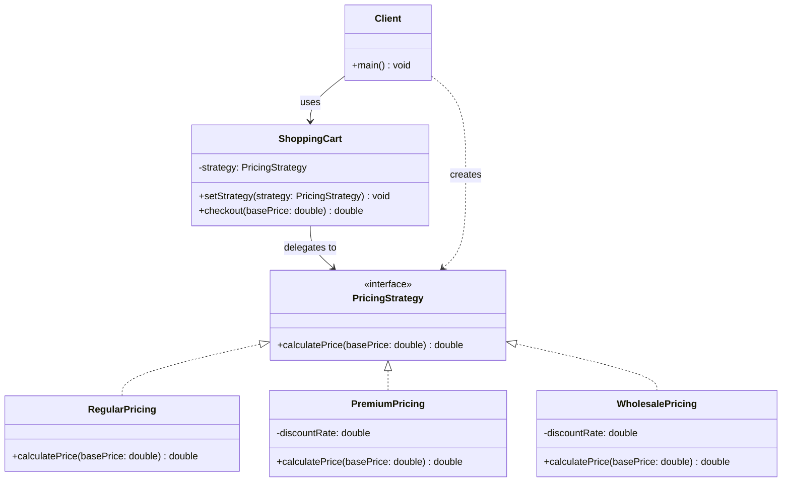

# Strategy Pattern

## 1. Problem

### What real software problem does this pattern solve?

You have an operation that can be performed in **multiple different ways**, and you need to switch between those ways at runtime. Without Strategy, you end up embedding all the variations inside a single class using `if/else` or `switch` statements.

```java
// Without Strategy — all pricing logic crammed into one method
public double calculatePrice(Order order) {
    if (order.getCustomerType().equals("regular")) {
        return order.getTotal();
    } else if (order.getCustomerType().equals("premium")) {
        return order.getTotal() * 0.9; // 10% discount
    } else if (order.getCustomerType().equals("employee")) {
        return order.getTotal() * 0.7; // 30% discount
    } else if (order.getCustomerType().equals("wholesale")) {
        return order.getTotal() * 0.6; // 40% discount
    }
    // ... keeps growing forever
}
```

### What becomes difficult without it?

- **God classes** — One class grows to handle every variation of the algorithm.
- **Violates Open/Closed Principle** — Adding a new algorithm means modifying existing, tested code.
- **Can't swap behavior at runtime** — The algorithm is hardwired via conditionals.
- **Testing is painful** — You can't test each algorithm in isolation; you test the entire bloated class.
- **Code duplication** — If two algorithms share steps, you end up copying code or creating fragile internal helpers.

---

## 2. Core Idea

The Strategy pattern **extracts each algorithm/behavior into its own class**, all sharing a common interface. The class that needs the behavior (the **Context**) holds a reference to a strategy object and delegates the work to it. You can swap the strategy at runtime without changing the context.

**Think of it like this:** Instead of a Swiss Army knife that does everything, you have a handle (context) and interchangeable blades (strategies).

---

## 3. When to Use It

| Signal | Example |
|--------|---------|
| Multiple algorithms for the same task | Different sorting algorithms, pricing rules, validation strategies |
| You see `if/else` chains selecting behavior, not creating objects | `if (type == "A") doAlgoA(); else if (type == "B") doAlgoB();` |
| You need to swap behavior at runtime | A navigation app switching between driving/walking/cycling routes |
| Algorithms change independently of the code that uses them | New discount types added quarterly without touching checkout logic |
| You want to test algorithms in isolation | Unit test each pricing strategy independently |

### Strategy vs Factory — When to Use Which?

| If you're... | Use... |
|-------------|--------|
| Choosing **which object to create** | Factory |
| Choosing **which behavior/algorithm to execute** | Strategy |

---

## 4. When NOT to Use It

| Situation | Why it's harmful |
|-----------|-----------------|
| You only have **2 algorithms** that will never change | A simple `if/else` is more readable |
| The algorithm is **tightly coupled** to the context's internal state | Passing lots of internal data to the strategy defeats encapsulation |
| The algorithms **don't share the same signature** | If they need different inputs/outputs, they don't share an interface |
| You're over-engineering a one-off script | Patterns are for code that lives long and changes often |
| The "strategies" are **trivially different** | If the difference is one line, a lambda or parameter is better |

> **Rule of thumb:** If your `if/else` is in one place, is small, and doesn't change — leave it alone.

---

## 5. Structure

### Classes/Interfaces Involved

| Component | Role |
|-----------|------|
| `Strategy` (interface) | Declares the method that all concrete strategies must implement |
| `ConcreteStrategyA`, `ConcreteStrategyB` | Each encapsulates one specific algorithm |
| `Context` | Holds a reference to a Strategy and delegates work to it. The context is NOT a strategy itself — it uses one |
| `Client` | Creates a concrete strategy and passes it to the context |

### Who Calls Whom

```
Client  →  creates ConcreteStrategyA
Client  →  context.setStrategy(strategyA)
Client  →  context.executeOperation()
                └──→  strategy.execute()   (delegated to the strategy object)
```

### Class Diagram



---

## 6. How to Code (Step-by-Step Recipe)

### Step 1: Identify the Varying Behavior

Look at your code and find the part that changes — the algorithm, rule, or behavior that has multiple variants. This will become your strategy interface.

**Ask yourself:** "What is the one thing that varies?"

### Step 2: Define the Strategy Interface (1 interface)

Create an interface with a **single method** (or few closely related methods) that represents the varying behavior.

```java
interface Strategy {
    Result execute(Input input);
}
```

**Key rule:** The method signature must work for ALL variants. If one variant needs extra data, either pass it through the method or rethink your design.

### Step 3: Create Concrete Strategies (N classes, one per algorithm)

Each class implements the Strategy interface with its own version of the algorithm.

```java
class ConcreteStrategyA implements Strategy {
    public Result execute(Input input) {
        // Algorithm A
    }
}
```

**Count:** One class per algorithm variant.

### Step 4: Create the Context (1 class)

The context holds a strategy reference and delegates to it. It does NOT contain algorithm logic itself.

```java
class Context {
    private Strategy strategy;

    public void setStrategy(Strategy strategy) {
        this.strategy = strategy;
    }

    public Result doWork(Input input) {
        return this.strategy.execute(input); // DELEGATE, don't implement
    }
}
```

**Two ways to inject the strategy:**
- **Constructor injection** — When the strategy doesn't change after creation
- **Setter injection** — When you need to swap strategies at runtime

### Step 5: Client Wires It Together

```java
Context ctx = new Context();
ctx.setStrategy(new ConcreteStrategyA());
ctx.doWork(input);

// Later, swap to a different algorithm at runtime
ctx.setStrategy(new ConcreteStrategyB());
ctx.doWork(input);
```

### Summary Checklist

| What to create | Count | Purpose |
|---------------|-------|---------|
| Strategy interface | 1 | Declares the algorithm contract |
| Concrete Strategy classes | N (one per algorithm) | Each implements one algorithm |
| Context class | 1 | Holds strategy reference, delegates work |
| Client code | wires things | Creates strategy, injects into context |

### Memory Trick

```
Factory  = "WHAT to create"     → returns an object
Strategy = "HOW to do something" → executes behavior
```

---

## 7. Code Implementation

### Example: Payment Processing System

```java
// ─────────────────────────────────────────────
// STEP 1: Strategy Interface
// ─────────────────────────────────────────────
public interface PaymentStrategy {
    /**
     * Process a payment and return a transaction ID.
     */
    String pay(double amount);

    /**
     * Name of this payment method for receipts/logs.
     */
    String getPaymentMethod();
}

// ─────────────────────────────────────────────
// STEP 2: Concrete Strategies
// ─────────────────────────────────────────────
public class CreditCardPayment implements PaymentStrategy {
    private String cardNumber;
    private String expiryDate;

    public CreditCardPayment(String cardNumber, String expiryDate) {
        this.cardNumber = cardNumber;
        this.expiryDate = expiryDate;
    }

    @Override
    public String pay(double amount) {
        // In real code: call payment gateway API (Stripe, etc.)
        String last4 = cardNumber.substring(cardNumber.length() - 4);
        System.out.printf("[CREDIT CARD] Charging $%.2f to card ending in %s%n", amount, last4);
        return "CC-TXN-" + System.currentTimeMillis();
    }

    @Override
    public String getPaymentMethod() {
        return "Credit Card";
    }
}

public class PayPalPayment implements PaymentStrategy {
    private String email;

    public PayPalPayment(String email) {
        this.email = email;
    }

    @Override
    public String pay(double amount) {
        // In real code: call PayPal REST API
        System.out.printf("[PAYPAL] Charging $%.2f to %s%n", amount, email);
        return "PP-TXN-" + System.currentTimeMillis();
    }

    @Override
    public String getPaymentMethod() {
        return "PayPal";
    }
}

public class CryptoPayment implements PaymentStrategy {
    private String walletAddress;

    public CryptoPayment(String walletAddress) {
        this.walletAddress = walletAddress;
    }

    @Override
    public String pay(double amount) {
        // In real code: interact with blockchain / crypto payment processor
        System.out.printf("[CRYPTO] Sending $%.2f to wallet %s%n", amount, walletAddress);
        return "CRYPTO-TXN-" + System.currentTimeMillis();
    }

    @Override
    public String getPaymentMethod() {
        return "Cryptocurrency";
    }
}

// ─────────────────────────────────────────────
// STEP 3: Context
// ─────────────────────────────────────────────
public class ShoppingCart {
    private List<String> items = new ArrayList<>();
    private double total = 0;
    private PaymentStrategy paymentStrategy; // ← holds the strategy

    public void addItem(String item, double price) {
        items.add(item);
        total += price;
    }

    // Setter injection — allows swapping at runtime
    public void setPaymentStrategy(PaymentStrategy strategy) {
        this.paymentStrategy = strategy;
    }

    public String checkout() {
        if (paymentStrategy == null) {
            throw new IllegalStateException("No payment method selected!");
        }

        System.out.println("=== Checkout ===");
        System.out.println("Items: " + items);
        System.out.printf("Total: $%.2f%n", total);
        System.out.println("Paying with: " + paymentStrategy.getPaymentMethod());

        // DELEGATE payment to the strategy — the cart doesn't know HOW payment works
        String txnId = paymentStrategy.pay(total);

        System.out.println("Transaction ID: " + txnId);
        System.out.println("================\n");
        return txnId;
    }
}

// ─────────────────────────────────────────────
// STEP 4: Client Code
// ─────────────────────────────────────────────
public class Main {
    public static void main(String[] args) {
        ShoppingCart cart = new ShoppingCart();
        cart.addItem("Laptop", 999.99);
        cart.addItem("Mouse", 29.99);

        // User selects credit card at checkout
        cart.setPaymentStrategy(new CreditCardPayment("4111111111111234", "12/25"));
        cart.checkout();

        // Same cart, different payment method — swapped at runtime
        cart.setPaymentStrategy(new PayPalPayment("user@example.com"));
        cart.checkout();

        // Or crypto
        cart.setPaymentStrategy(new CryptoPayment("0xABC123..."));
        cart.checkout();
    }
}
```

**Output:**
```
=== Checkout ===
Items: [Laptop, Mouse]
Total: $1029.98
Paying with: Credit Card
[CREDIT CARD] Charging $1029.98 to card ending in 1234
Transaction ID: CC-TXN-1696700000001
================

=== Checkout ===
Items: [Laptop, Mouse]
Total: $1029.98
Paying with: PayPal
[PAYPAL] Charging $1029.98 to user@example.com
Transaction ID: PP-TXN-1696700000002
================

=== Checkout ===
Items: [Laptop, Mouse]
Total: $1029.98
Paying with: Cryptocurrency
[CRYPTO] Sending $1029.98 to wallet 0xABC123...
Transaction ID: CRYPTO-TXN-1696700000003
================
```

---

## 8. Real-World Examples

| Where | How Strategy is used |
|-------|---------------------|
| **`Comparator<T>` in Java Collections** | `Collections.sort(list, comparator)` — the sorting algorithm is fixed, but the **comparison strategy** is interchangeable |
| **`javax.servlet.Filter` chain** | Each filter is a strategy for request processing (authentication, logging, CORS) |
| **Spring `AuthenticationProvider`** | Multiple authentication strategies (LDAP, OAuth2, JWT) behind one interface |
| **Compression in HTTP** | Server selects compression strategy (gzip, br, deflate) based on `Accept-Encoding` header |
| **Rate limiters** | Token bucket vs sliding window vs fixed window — all implement a `RateLimiter` interface |
| **Retry policies** | Exponential backoff vs linear vs immediate — strategies for how to retry failed operations |
| **`PasswordEncoder` in Spring Security** | BCrypt, Argon2, PBKDF2 — different hashing strategies behind one interface |

---

## 9. Trade-offs

### ✅ Advantages

- **Open/Closed Principle** — Add new algorithms without touching context or existing strategies
- **Runtime flexibility** — Swap behavior on the fly based on user input, config, or state
- **Isolated testing** — Test each algorithm independently with its own unit tests
- **Eliminates conditionals** — Replaces sprawling `if/else`/`switch` chains with polymorphism
- **Single Responsibility** — Each strategy class has one job

### ❌ Disadvantages

- **Client must know about all strategies** — Someone has to decide which strategy to use (often solved by combining with Factory)
- **Class proliferation** — N algorithms = N classes, which can feel heavy for simple cases
- **Communication overhead** — Strategy might need data from the context; you either pass it via method params or create coupling
- **Over-engineering risk** — If the behavior rarely changes, a simple `if/else` is more maintainable

### Complexity Introduced

| Aspect | Impact |
|--------|--------|
| Number of new files | 1 interface + N strategies + 1 context = N+2 minimum |
| Indirection layers | 1 extra layer (context → strategy) |
| Learning curve | Low — very intuitive pattern |
| Maintenance burden | Low for each strategy; medium for managing which strategy to use where |
| Common pairing | Often combined with **Factory** to hide the strategy selection logic |
